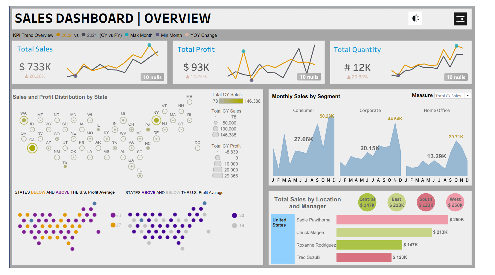
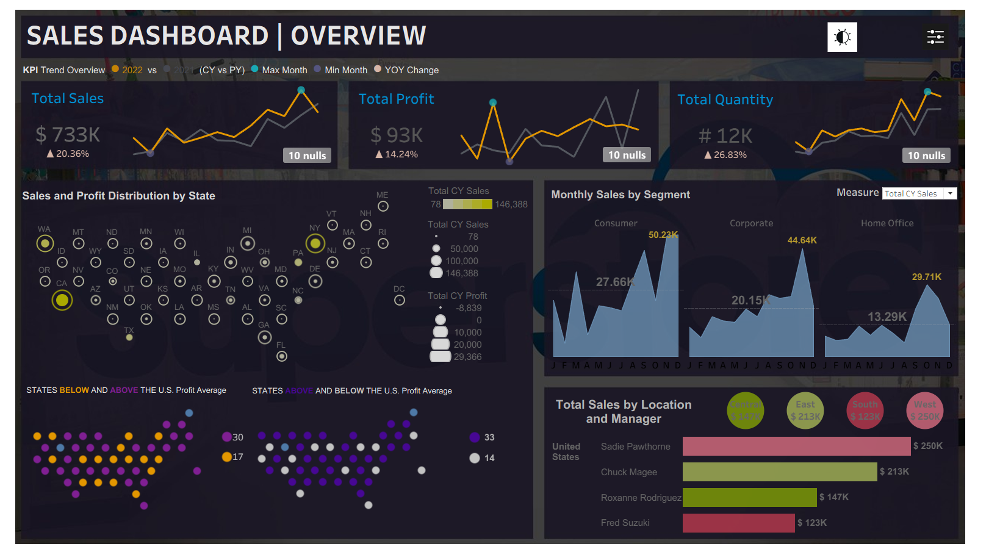
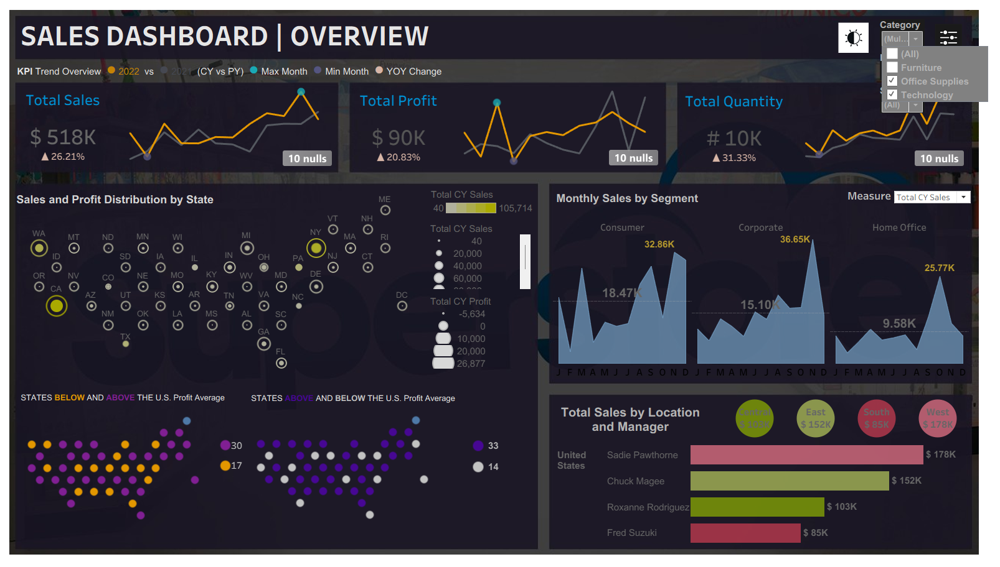
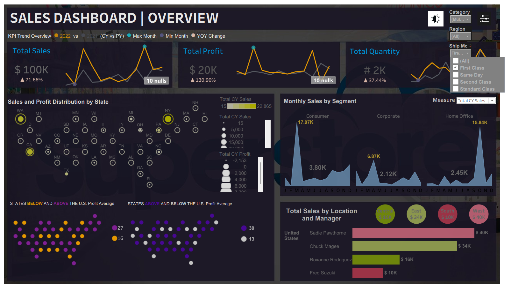

# 📊 Tableau Sales Dashboard

An interactive **Sales Analytics Dashboard built with Tableau** to analyze sales performance, profitability, quantity trends, and geographical distribution. The dashboard combines **KPIs, time-series analysis, interactive maps, filters, and multiple visualization techniques** to provide a comprehensive view of business performance.

---

## 🚀 Project Overview

This dashboard provides an interactive way to explore sales data across different **years, regions, segments, and geographical locations**.

Users can dynamically filter the dashboard and switch between **Light and Dark themes** to improve the viewing experience.

The dashboard focuses on answering questions such as:

- How are sales performing over time?
- What are the yearly trends in sales and quantity?
- Which regions contribute the most to sales?
- How is profit distributed geographically?
- Which areas and segments have higher average sales?
- How do different regions compare in terms of sales and profitability?

---

## ✨ Key Features

### 🎯 KPI Cards

The dashboard includes key performance indicators for quickly understanding overall business performance:

- **Total Sales**
- **Total Profit**
- **Total Quantity**
- Additional performance metrics based on selected filters

The KPI values dynamically update according to the selected filters.

---

### 📈 Yearly Sales & Quantity Trends

A **line chart** is used to visualize yearly trends and identify changes in:

- Sales
- Quantity
- Overall performance over time

This makes it easier to identify growth patterns, fluctuations, and changes in business performance.

---

### 🗺️ Geographical Sales Distribution

Interactive maps are used to visualize the geographical distribution of sales.

The maps help identify:

- High-sales regions
- Low-sales regions
- Geographical concentration of business
- Regional differences in performance

---

### 💰 Sales by Region Map

A dedicated map visualizes **average sales by region**, allowing users to compare regional sales performance geographically.

Users can interact with the map to explore individual regions and their corresponding sales values.

---

### 📊 Profit by Region Map

A separate geographical visualization represents **average profit by region**.

This allows users to analyze:

- Regions generating higher profits
- Regions with comparatively lower profitability
- Geographic patterns in profit generation

---

### ⭕ Segment & Area Analysis

A **circle/bubble map visualization** is used to analyze sales across different areas and segments.

This provides a visual comparison of:

- Sales concentration
- Customer segments
- Geographic areas
- Relative performance

---

### 📊 Horizontal Bar Chart

A horizontal bar chart is used for comparing categories and identifying the highest and lowest performing areas/segments.

This visualization makes category-level comparisons easier and provides a clear ranking of performance.

---

## 🎛️ Interactive Filters

The dashboard contains interactive filters that allow users to dynamically analyze the data.

Users can filter the dashboard based on relevant dimensions such as:

- Year
- Region
- Segment
- Area
- Other available categorical fields

All connected visualizations update based on the selected filters.

---

## 🌗 Light & Dark Theme

The dashboard provides both:

- ☀️ **Light Theme**
- 🌙 **Dark Theme**

Users can switch between themes depending on their viewing preference.

The theme option improves usability and provides a more modern dashboard experience.

---

## 📌 Dashboard Components

| Visualization | Purpose |
|---|---|
| KPI Cards | Overall business performance |
| Line Chart | Yearly sales and quantity trends |
| Geographic Map | Sales distribution |
| Sales Map | Average sales by region |
| Profit Map | Average profit by region |
| Circle/Bubble Map | Area and segment analysis |
| Horizontal Bar Chart | Category comparison |
| Filters | Interactive data exploration |
| Theme Toggle | Light/Dark viewing experience |

---

## 🛠️ Tools & Technologies

- **Tableau**
- **Data Visualization**
- **Business Intelligence**
- **Interactive Dashboards**
- **Geographical Analysis**
- **KPI Analysis**
- **Data Analytics**

---

## 📂 Project Structure

```text
Tableau-Sales-Dashboard/
│
├── README.md
│
├── Icon/
│   │── filter1.jpg
│   │── filter2.png
│   └── theme.jpg
│
├── Tableau Sales Dashboard.twb
├── hexmap.xlsx
├── Sales_Data.xls
│
├── Sales Dashboard Background/
│   │── Slide1.jpg
│   │── Slide2.jpg
│   │── Slide3.jpg
│   │── Slide4.jpg
│   └── Slide5.jpg
│
│
└── Screenshots/
    │── dark.jpg
    │── filter1.jpg
    │── filter2jpg
    └── light.jpg
```

---

## 📊 Dashboard Workflow

```text
Raw Sales Data
      ↓
Data Preparation
      ↓
Data Analysis
      ↓
Calculated Fields
      ↓
KPI Development
      ↓
Charts & Maps
      ↓
Interactive Filters
      ↓
Light/Dark Theme
      ↓
Final Tableau Dashboard
```

---

## 🎯 Insights Provided

The dashboard enables users to identify:

- Overall sales and profit performance
- Year-over-year sales trends
- Changes in quantity over time
- Geographical sales patterns
- Regional sales performance
- Regional profitability
- Segment-level performance
- High and low-performing areas
- Relationship between sales and geographic distribution

---

## 📷 Dashboard Preview

Add your dashboard screenshot here:

### Light Theme


### Dark Theme


### Filter





---

## 💡 Use Case

This dashboard can be used by:

- Sales teams
- Business analysts
- Data analysts
- Management teams
- Business intelligence teams

to monitor performance and explore sales data interactively.

---

## 📚 Skills Demonstrated

- Tableau Dashboard Development
- Data Visualization
- KPI Design
- Time-Series Analysis
- Geospatial Visualization
- Sales & Profit Analysis
- Interactive Filtering
- Dashboard UI/UX
- Business Intelligence
- Data Storytelling

---

## 👨‍💻 Author

**Mayank Raj**

Data Science & Analytics Enthusiast

---

⭐ If you find this project useful, feel free to explore the repository and connect with me.